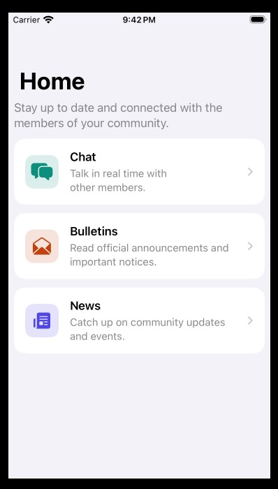
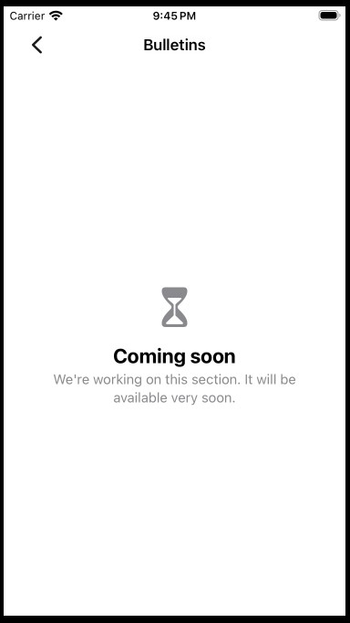

# inga-app

App iOS para que los miembros de una comunidad se mantengan comunicados: chatear entre ellos, recibir boletines oficiales y seguir las noticias de la comunidad.

## Características

### Pantalla de inicio (Home)
Es el punto de entrada de la app y presenta las tres funcionalidades de comunicación:

| Funcionalidad | Descripción | Estado |
|---|---|---|
| **Chat** | Conversaciones en tiempo real con otros miembros. | Próximamente |
| **Boletines** | Comunicados oficiales y avisos importantes. | Próximamente |
| **Noticias** | Novedades y eventos de la comunidad. | Próximamente |

Mientras un módulo no esté implementado, al pulsar su tarjeta se muestra una pantalla de "Próximamente", así el toque nunca se queda sin respuesta.

### Experiencia de usuario y accesibilidad
- **Dynamic Type:** el texto se adapta al tamaño elegido por el usuario. Con tamaños de accesibilidad, las tarjetas pasan a disposición vertical.
- **VoiceOver:** cada tarjeta es un único botón con una etiqueta descriptiva.
- **Modo claro y oscuro** con colores semánticos del sistema.
- **Reducir movimiento:** se respeta la preferencia del sistema en las animaciones.
- **iPhone y iPad:** una columna en pantallas estrechas y tres en anchas.
- **Idiomas:** español e inglés (String Catalog).
- **Soporte para idiomas de derecha a izquierda** en los iconos de navegación.

## Demo

### Home

Pantalla de inicio con las tres funcionalidades de comunicación. Cada una tiene su icono, su color y una breve descripción.



### Boletines

Al pulsar una tarjeta cuyo módulo aún no está disponible se abre un estado vacío informativo.



> Las capturas muestran la app en inglés y en modo claro. Con el dispositivo en español, los textos aparecen traducidos automáticamente.

## Requisitos

| | Versión |
|---|---|
| Xcode | 26.6 o superior |
| iOS (deployment target) | 26.5 |
| Lenguaje | Objective‑C |
| Dependencias externas | Ninguna |

## Cómo ejecutar

1. Clona el repositorio.
2. Abre `inga-app.xcodeproj` en Xcode.
3. Selecciona el esquema `inga-app` y un simulador o dispositivo.
4. Ejecuta con <kbd>⌘</kbd> + <kbd>R</kbd>.

Para ejecutarlo en un dispositivo físico, cambia el *Development Team* en *Signing & Capabilities* por el tuyo.

## Arquitectura

La app usa **MVVM + Coordinator** y aplica las capas de **Clean Architecture** en versión ligera:

```
View (UIKit) ──▶ ViewModel (Foundation) ──▶ Provider (protocolo de dominio)
                      │                              ▲
                      ▼                              │
                 Coordinator ─────── inyecta ─── implementación (Data)
```

- **View:** pinta el estado y reenvía las interacciones al ViewModel. No navega ni contiene lógica.
- **ViewModel:** prepara los datos para mostrarlos. No importa UIKit, así que se puede probar con tests unitarios.
- **Coordinator:** gestiona la navegación y crea las pantallas con sus dependencias.
- **`INGAppCoordinator`:** es el *composition root*, el único lugar donde se eligen las implementaciones concretas.

## Estructura del proyecto

```
inga-app/
├── Core/
│   └── Coordinator/            # Protocolo Coordinator y AppCoordinator
├── Features/
│   └── Home/
│       ├── Domain/             # Entidades y protocolos (sin UIKit)
│       ├── Data/               # Implementaciones de los protocolos
│       ├── Presentation/
│       │   ├── ViewModels/     # Lógica de presentación (sin UIKit)
│       │   └── Views/          # ViewControllers, celdas y vistas
│       └── Coordinator/        # Navegación de la feature
├── Assets.xcassets/            # Iconos y colores (con variante oscura)
├── Localizable.xcstrings       # Textos en español e inglés
├── AppDelegate / SceneDelegate
└── main.m
```

Cada nueva funcionalidad (Chat, Boletines, Noticias…) se crea como una carpeta en `Features/` con la misma estructura.

## Convenciones

- **Prefijo `ING`** en todas las clases, porque Objective‑C no tiene *namespaces*.
- **UI por código.** No se usan storyboards (salvo el `LaunchScreen`).
- **Nullability explícita** con `NS_ASSUME_NONNULL_BEGIN/END`.
- **Inicializadores designados** que reciben las dependencias. `init`/`new` están marcados como `NS_UNAVAILABLE`.
- **Ningún texto visible escrito directamente en el código:** todo pasa por `NSLocalizedString` y `Localizable.xcstrings`.
- **Colores:** semánticos del sistema o definidos en el Asset Catalog con variante oscura.
- **Comentarios del código en inglés.**
- **Archivos nuevos:** el proyecto usa *file system synchronized groups*, así que los archivos que se añaden a `inga-app/` entran al target sin tocar el `.pbxproj`.

## Licencia

Distribuido bajo la licencia **GNU GPL v3**. Ver [LICENSE](LICENSE).
